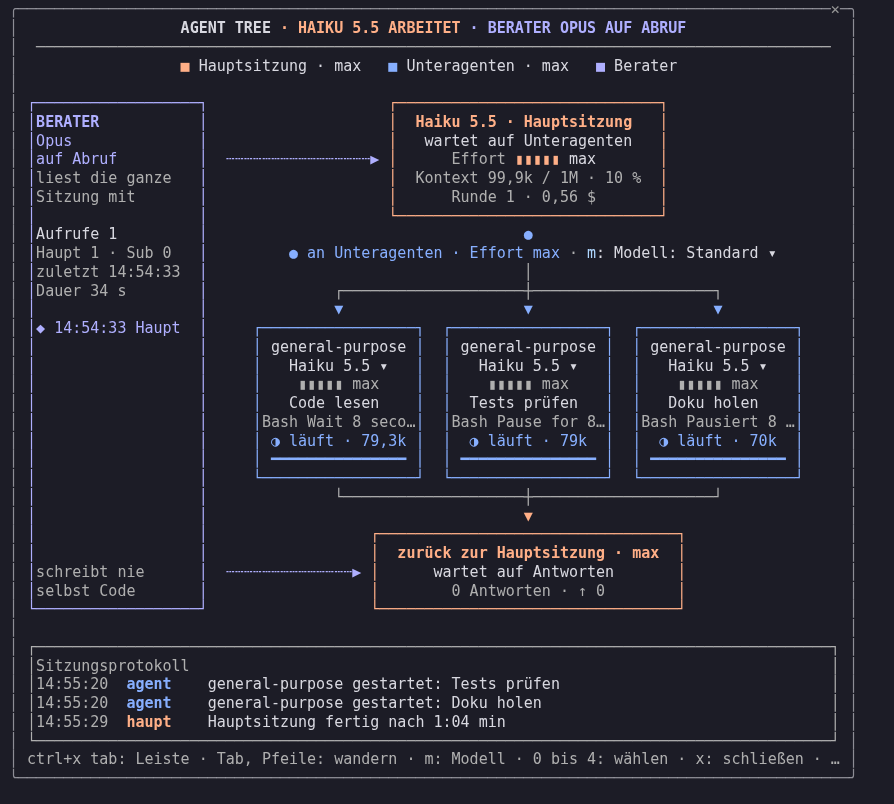

# Agent Tree

[English](README.md)

Seitenleiste fürs Terminal, die die Agenten einer Sitzung als Kästen zeichnet: Hauptsitzung, Unteragenten, Rückweg zur Hauptsitzung, Berater und Sitzungsprotokoll.



## Installation

```
/plugin install agent-tree --marketplace MikeGT4/agent-tree
```

Getestet mit den Versionen 2.1.307 und 2.1.308, Voraussetzung ist die Mod-Schnittstelle.

## Bedienung

`/agent-tree` öffnet die Leiste, `/agent-tree stop` schließt sie, `/agent-tree clear` beginnt den Baum neu. Ein Klick auf den Typ zeigt Auftrag, Werkzeuge und letzte Antwort; dort lässt sich ein laufender Agent stoppen. Wer auf das Modell klickt, stellt einen laufenden Agenten um, „Modell“ legt es für neue Unteragenten fest. Jeder Kasten hat einen Zeitbalken, im Kasten der Hauptsitzung stehen die Kosten. Tasten: ctrl+x tab wählt die Leiste, m öffnet die Modellwahl, 0 bis 4 wählen, x schließt, s stoppt.

Einstellungen: Breite, Zahl der Agenten, Öffnen beim Start, Bewegung, Sprache (auto, de, en).

## Lizenz

MIT, © 2026 Mike Pollow, Digitalroots
