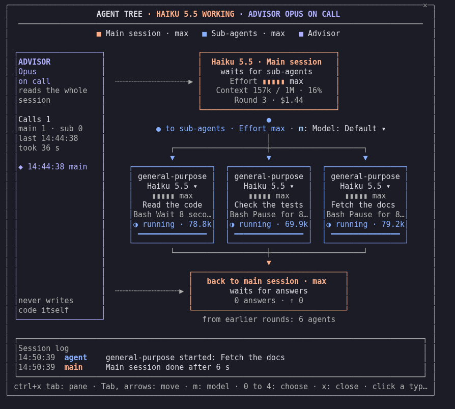

# Agent Tree

Seitenleiste fürs Terminal, die die Agenten einer Sitzung als Kästen zeichnet: Hauptsitzung, Unteragenten, Rückweg zur Hauptsitzung, Berater und Sitzungsprotokoll.



## Installation

```
/plugin install agent-tree --marketplace MikeGT4/agent-tree
```

Getestet mit den Versionen 2.1.307 und 2.1.308, Voraussetzung ist die Mod-Schnittstelle.

## Bedienung

`/agent-tree` öffnet die Leiste, mit `stop` dahinter schließt sie sich, mit `clear` beginnt der Baum neu. Das Modell für neue Unteragenten dieser Sitzung wählt ein Klick auf „Modell ▾“. Wer auf das Modell in einem laufenden Kasten klickt, stellt diesen Agenten für seine nächsten Schritte um. Ab 84 Spalten Breite steht der Berater in einer eigenen Spalte.

Im Konfigurationsmenü stehen Breite, Zahl der Agenten, Öffnen beim Start und Bewegung.

## Lizenz

MIT, © 2026 Mike Pollow, Digitalroots
