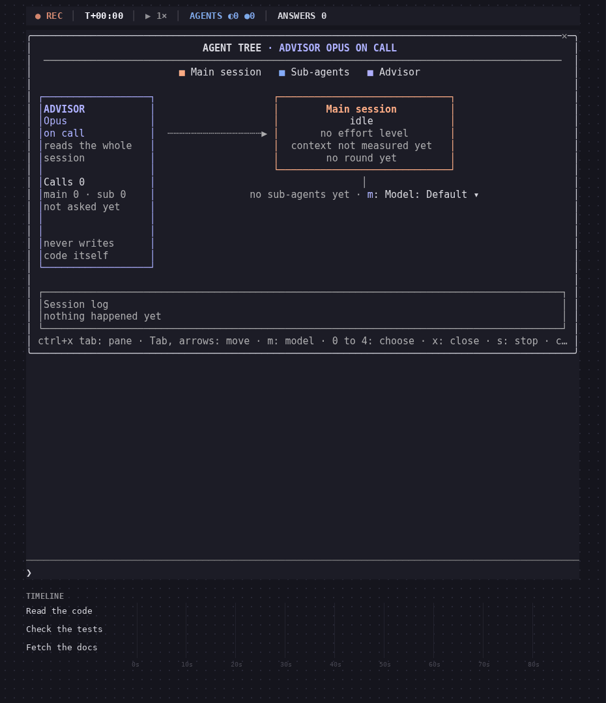

# Agent Tree

[Deutsch](README.de.md)

A side pane for the terminal that draws a session's agents as a tree of boxes: main session, sub-agents, the way back, the advisor and a session log.



## Install

```
/plugin install agent-tree --marketplace MikeGT4/agent-tree
```

Tested with versions 2.1.307 and 2.1.308; it needs the mod interface.

## Use

`/agent-tree` opens the pane, `/agent-tree stop` closes it, `/agent-tree clear` starts afresh. Click a type for its task, tools and latest answer, and to stop it. Clicking a model switches a running agent; "Model" sets it for new sub-agents. Boxes carry a timeline bar, the main box the session's cost. Keys: ctrl+x tab focuses the pane, m model, 0 to 4 pick, x close, s stop.

Settings: width, agents kept, open on start, motion, language (auto, de, en).

## License

MIT, © 2026 Mike Pollow, Digitalroots
